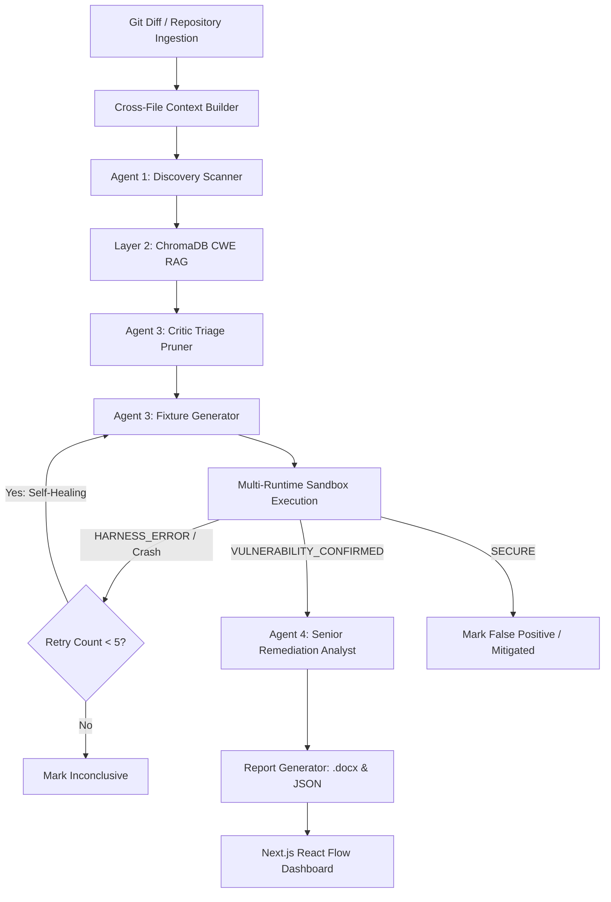
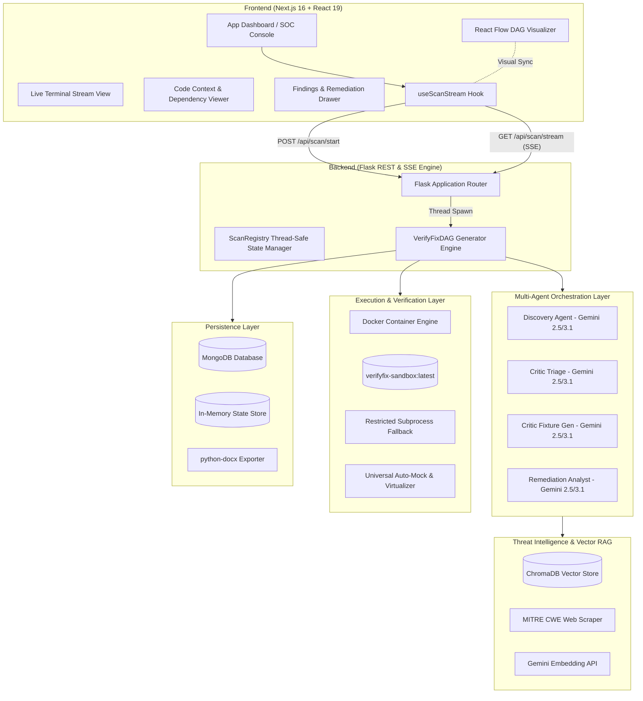
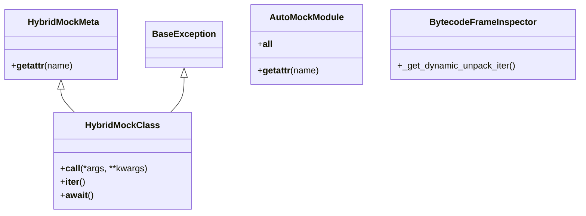

# 🏛️ VerifyFix Platform Architecture & Engineering Blueprint

> **System Version:** 2.0.0  
> **Target Environment:** Multi-Agent Security Validation & Remediation Platform  
> **Source Base:** Full Codebase Audit (`backend/`, `frontend/`, `TECH_STACK_AUDIT.md`)

---

## 1. Executive Overview & Core Philosophy

**VerifyFix** is an execution-grounded vulnerability validation and autonomous remediation platform. Traditional Static Application Security Testing (SAST) tools suffer from notoriously high false-positive rates (often 40–70%) because they evaluate source code heuristically without runtime validation. 

VerifyFix eliminates false positives through an **empirical multi-agent pipeline**:
1. **Discover:** Candidate vulnerabilities are extracted from code diffs and full project context using reasoning LLMs.
2. **Contextualize (RAG):** Candidate vulnerabilities are enriched with live MITRE CWE threat intelligence from a local ChromaDB vector store.
3. **Criticize & Generate Fixture:** A Critic Agent prunes candidates neutralized by framework protections and generates targeted, executable test harnesses.
4. **Empirically Execute (Sandbox):** Test harnesses run inside a strictly isolated, network-disabled Docker container (or locked-down process sandbox).
5. **Self-Heal:** If a harness fails due to runtime syntax errors or import defects, an execution feedback loop automatically repairs the test harness.
6. **Remediate:** Confirmed vulnerabilities receive surgical unified git diff patches and defense-in-depth architectural guidance from a Senior Analyst agent.



---

## 2. High-Level System Architecture

The platform follows a decoupled, asynchronous client-server architecture with real-time streaming:



---

## 3. The 8-Stage Execution DAG Engine

The execution pipeline is implemented in [backend/agents/graph.py](file:///c:/Users/VICTUS/OneDrive/Desktop/VerifyFix-main/backend/agents/graph.py) and [backend/agents/nodes.py](file:///c:/Users/VICTUS/OneDrive/Desktop/VerifyFix-main/backend/agents/nodes.py) as a LangGraph-patterned generator that yields real-time Server-Sent Events (SSE).

### Stage 1: GitHub Ingestion (`node_github_ingest`)
* **Objective:** Parses the incoming diff or retrieves branch commits via GitHub API.
* **Full Context Resolution (`services/github_context.py`):**
  - Extracts changed file paths from unified git diffs (`+++ b/...`).
  - Fetches the full contents of all changed files (up to 50KB/file, max 15 files).
  - Uses Python AST parsing (`ast.parse`) to detect all internal `import` and `from ... import` statements.
  - Recursively fetches sibling dependency modules from GitHub to resolve cross-file data flows.
  - Produces a project directory tree and semantic context summary.

### Stage 2: Discovery Agent (`node_discovery`)
* **Model:** Gemini 2.5 / 3.1 Flash-Lite (`temperature=0.2`).
* **Objective:** Conducts an exhaustive source-to-sink vulnerability audit across all security domains (injection, path traversal, auth/CSRF bypass, ReDoS, memory exhaustion).
* **Output:** Normalized list of `candidate_vulns` containing:
  - `cwe_id` (leaf-level MITRE identifier, e.g., CWE-89, CWE-22, CWE-1333)
  - `vulnerability_name`, `file_path`, `line_start`, `line_end`
  - `suspect_code`, `reasoning`, `source_to_sink_trace`
* **Fallback:** AST and heuristic regex pattern matcher (`fallback_heuristic_analyzer`) when operating offline.

### Stage 3: RAG Threat Intelligence Enrichment (`node_rag`)
* **Service:** [backend/rag/chroma_service.py](file:///c:/Users/VICTUS/OneDrive/Desktop/VerifyFix-main/backend/rag/chroma_service.py) + [backend/rag/cwe_fetcher.py](file:///c:/Users/VICTUS/OneDrive/Desktop/VerifyFix-main/backend/rag/cwe_fetcher.py).
* **Mechanism:**
  1. For each unique `cwe_id`, queries the local ChromaDB collection `threat_intelligence`.
  2. If missing, dynamically scrapes `https://cwe.mitre.org/data/definitions/<id>.html` via BeautifulSoup4.
  3. Vectorizes content using `models/gemini-embedding-2` (`task_type="retrieval_document"`).
  4. Stores cosine-similarity vector embeddings and attaches remediation advice and exploit mechanics to `state["rag_context"]`.

### Stage 4: Critic Agent (`node_critic`)
Operates in two distinct sequential phases:
* **Phase I: Triage Pruning (`run_triage_pruning`):**
  - Evaluates candidates against full file context.
  - Prunes findings if verifiable framework-level mitigations exist in the diff (e.g., ORM parameterization, CSRF middleware, auto-escaping).
  - Preserves library reachability: refuses to prune helper/utility classes without routes if public API methods are callable.
* **Phase II: Test Fixture Generation (`run_fixture_generation`):**
  - Generates standalone, self-contained Python (`.py`) or JavaScript (`.js`) test scripts.
  - **Dynamic Module Loading:** Strictly prohibits copy-pasting source code into triple-quoted strings; scripts must load the target file from disk via `importlib.util.spec_from_file_location`.
  - **OS Adaptation:** Injects host OS parameters (`Windows`, `Linux`, `Darwin`) to dynamically adapt paths and execution primitives.
  - **Framework Clients:** Forces use of `app.test_client()` (Flask) or `TestClient(app)` (FastAPI) instead of binding network ports.
  - **Read-Only Compatibility:** Enforces `tempfile.TemporaryDirectory()` for file-system tests to avoid read-only mount crashes.

### Stage 5: Sandbox Execution (`node_sandbox`)
* **Service:** [backend/sandbox/runner.py](file:///c:/Users/VICTUS/OneDrive/Desktop/VerifyFix-main/backend/sandbox/runner.py).
* **Runtime Detection:** Analyzes code patterns, extensions, and file paths to select the appropriate runtime (`python`, `javascript`, or `bash`).
* **Isolation Mechanisms:**
  - **Docker Mode:** Executes in container with `--network none`, `--memory 512m`, `--cpus 1.0`, read-only workspace mount (`-v <workspace>:/app:ro`), and writable `/tmp`.
  - **Process Fallback:** If Docker is unavailable, executes local subprocess with stripped sensitive environment variables (`GEMINI_API_KEY`, `GITHUB_TOKEN`, `MONGO_URI`).
* **Verdict Protocol:**
  - `[VULNERABILITY_CONFIRMED]` + exit code 0 ➔ **Exploit Proven**
  - `[SECURE]` + exit code 0 ➔ **Mitigated / False Positive**
  - Non-zero exit code / timeout / trace crash ➔ **`HARNESS_ERROR`**

### Stage 6: Self-Healing Feedback Edge (`should_retry`)
* **Conditional Routing:** Evaluates `state["docker_status"]`.
* **Logic:** If any fixture resulted in `HARNESS_ERROR` and `retry_count < 5`:
  1. Captures `stderr` and stack traces into `state["harness_error_traces"]`.
  2. Increments `retry_count`.
  3. Re-routes execution back to **Stage 4 (Critic Agent)**.
  4. Injects previous error traces and instructions to register lightweight mock modules in `sys.modules` to self-heal missing imports.
* **Termination:** Once all fixtures are either `VULNERABILITY_CONFIRMED` or `SECURE`, or `MAX_RETRIES` is reached, advances to Stage 7.

### Stage 7: Senior Remediation Analyst (`node_remediation`)
* **Model:** Gemini 2.5 / 3.1 Flash-Lite (`temperature=0.4`).
* **Input:** Confirmed vulnerability metadata, raw sandbox execution proof, git diff, and full source code.
* **Output:**
  - Detailed root cause analysis.
  - Surgical, syntactically valid unified git diff patch (`--- a/... \n +++ b/...`).
  - Three defense-in-depth architectural hardening recommendations.
  - CVSS severity calculation (e.g., `CRITICAL (CVSS 9.8)`).

### Stage 8: Pipeline Completion (`node_complete`)
* **Persistence:** Updates state to `COMPLETED`, records timestamps, persists execution session in MongoDB (or in-memory fallback), and prepares `.docx` audit report generation.

---

## 4. Universal Auto-Mock & Virtualization Subsystem

To run arbitrary untrusted repository code in an isolated sandbox without installing hundreds of third-party pip dependencies, VerifyFix features a custom virtualization engine: [backend/sandbox/auto_mock.py](file:///c:/Users/VICTUS/OneDrive/Desktop/VerifyFix-main/backend/sandbox/auto_mock.py).



### Key Architectural Capabilities:
1. **Hybrid Mock Class (`_HybridMockMeta`):** Inherits simultaneously from `BaseException` and `type`. This guarantees that `except MissingPackageError:` never raises `"TypeError: catching classes that do not inherit from BaseException"`, while `isinstance(val, MissingType)` and class inheritance (`class MyModel(MissingBase)`) evaluate cleanly.
2. **Dynamic Bytecode Unpacking:** Inspects caller bytecode frames (`sys._getframe(2)`) for `UNPACK_SEQUENCE` opcodes to dynamically yield the exact number of mock items expected by tuple assignments (`a, b = get_pair()`), eliminating `"ValueError: not enough values to unpack"`.
3. **Meta-Path Import Interceptor (`sys.meta_path`):** Dynamically catches uninstalled module imports on the fly and returns virtualized mock modules without failing execution.
4. **Package Namespace Synthesis:** Traverses staged file directories and automatically seeds missing `__init__.py` markers so relative intra-package imports (`from . import helpers`) resolve naturally.

---

## 5. State Schema & Data Contracts

All data flowing through the multi-agent graph conforms to strict `TypedDict` schemas defined in [backend/agents/state.py](file:///c:/Users/VICTUS/OneDrive/Desktop/VerifyFix-main/backend/agents/state.py):

### The Core State Object (`VerifyFixState`)
```python
class VerifyFixState(TypedDict):
    scan_id: str
    repo_owner: str
    repo_name: str
    branch_name: str
    github_token: str
    target_diff: str
    full_files: Dict[str, str]            # path -> full file source code
    dependency_files: Dict[str, str]      # imported dependency files
    file_tree: str                        # project directory hierarchy
    analyzed_context_summary: str
    candidate_vulns: List[VulnerabilityCandidate]
    rag_context: Dict[str, str]           # cwe_id -> threat intelligence
    pruned_vulns: List[VulnerabilityCandidate]
    generated_fixtures: Dict[str, str]    # vuln_key -> test script content
    docker_status: Dict[str, str]         # vuln_key -> VERDICT
    harness_error_traces: Dict[str, str]  # vuln_key -> stack trace
    retry_count: int
    final_remediations: List[RemediationItem]
    execution_step: str                   # Current DAG step literal
    logs: List[str]                       # Historical execution log array
    started_at: str                       # ISO UTC timestamp
    completed_at: Optional[str]
    error: Optional[str]
```

### Server-Sent Event (SSE) Protocol
The Flask streaming engine broadcasts progress to the frontend over `GET /api/scan/stream?scan_id=<id>` using five standard event schemas:
* `event: pipeline_start` ➔ Scan metadata, repository, branch, timestamp.
* `event: node_update` ➔ Active stage transition (`step`, `status`: `running` | `completed` | `looping`).
* `event: log` ➔ Real-time execution log messages with UTC timestamp.
* `event: state_delta` ➔ Incremental state mutations (new candidates, RAG keys, verdicts).
* `event: pipeline_end` ➔ Final completion notification and result summary.

---

## 6. Frontend SOC Dashboard Architecture

The frontend is a single-page Security Operations Center (SOC) dashboard built with **Next.js 16 (App Router)** and **React 19**:

```
frontend/src/
├── app/
│   ├── layout.tsx              # Dark theme wrapper, font configurations
│   ├── page.tsx                # Auto-redirects to /dashboard
│   └── dashboard/page.tsx      # Main SOC cockpit & tab manager
├── components/
│   ├── dag/
│   │   ├── DagVisualizer.tsx   # React Flow DAG interactive canvas
│   │   └── CustomNode.tsx      # Custom SVG/Tailwind nodes with glow & pulse states
│   ├── code/
│   │   └── CodeContextViewer.tsx # Tree & file viewer for changed + dep files
│   ├── terminal/
│   │   └── TerminalView.tsx    # Live color-coded log terminal
│   └── findings/
│       └── FindingsDrawer.tsx  # Confirmed vulnerabilities, metrics, .docx download
├── hooks/
│   └── useScanStream.ts        # Native EventSource SSE consumer & state reducer
└── lib/
    └── utils.ts                # Tailwind class composer (cn)
```

### Key UI Features:
1. **Interactive DAG Canvas (`@xyflow/react`):** Renders the 8 nodes and feedback edges. Nodes dynamically react to SSE updates, showing animated blue spinners when running, rose bug icons when vulnerabilities are confirmed, emerald shields when secure, and amber retry counters during self-healing loops.
2. **Context & Dependency Viewer:** Dual-pane browser that distinguishes between files modified in the PR/diff (amber badge) and dependency files fetched via AST resolution (cyan badge), complete with vulnerability line highlighting.
3. **Live SOC Terminal:** Monospace terminal with colorized prefix parsing (`[Discovery]`, `[Critic]`, `[Sandbox]`, `[Senior Analyst]`).
4. **Instant Export:** Direct download link for Microsoft Word `.docx` executive audit reports synthesized by [backend/services/report_generator.py](file:///c:/Users/VICTUS/OneDrive/Desktop/VerifyFix-main/backend/services/report_generator.py).

---

## 7. REST API & Endpoint Specification

| Method | Endpoint | Description | Request Payload / Params | Response |
| :--- | :--- | :--- | :--- | :--- |
| `GET` | `/` | Service health status | None | `{"status": "online", "service": "VerifyFix"}` |
| `GET` | `/health` | Core healthcheck | None | `{"status": "healthy"}` |
| `POST` | `/api/scan/start` | Launch asynchronous DAG scan | `{"repo_url", "branch_name", "token", "demo"}` | `{"success": true, "scan_id": "...", "stream_url": "..."}` |
| `GET` | `/api/scan/stream` | Real-time SSE stream | `?scan_id=<uuid>` | `text/event-stream` SSE event stream |
| `GET` | `/api/scan/status` | Polling endpoint for scan progress | `?scan_id=<uuid>` | `{"completed": bool, "state": {...}}` |
| `GET` | `/api/scan/result` | Retrieve final audit results | `?scan_id=<uuid>` | Full scan result dictionary & remediations |
| `GET` | `/api/scan/list` | List historical scans | None | `{"success": true, "scans": [...]}` |
| `POST` | `/api/github/repos` | Fetch user repositories | `{"token": "..."}` | `{"success": true, "repos": [...]}` |
| `GET` | `/api/github/branches` | Fetch branches for repository | `?owner=&repo=&token=` | `{"success": true, "branches": [...]}` |
| `GET` | `/api/github/diff` | Fetch compare diff | `?owner=&repo=&branch=&token=` | `{"success": true, "diff": "..."}` |
| `GET` | `/api/report/download`| Download `.docx` audit report | `?scan_id=<uuid>` | Binary `.docx` file stream |

---

## 8. Role of the Automated Test Suite (`backend/tests/`)

### Why the `tests/` Directory is Essential
Because VerifyFix orchestrates multiple autonomous LLM agents that write and execute dynamic code inside sandboxes, automated testing is essential to ensure platform integrity:
* **Prevents Regressions:** Ensures that improvements to agent prompts, AST parsers, or Docker harnesses never break the 8-stage state machine.
* **Automated CI/CD Quality Gate:** Powers the GitHub Actions pipeline, blocking broken builds from ever merging into `main`.

### What Happens During Test Execution in VerifyFix
When the test suite executes (`pytest backend/tests/`), it empirically verifies the end-to-end platform mechanics without incurring live API costs:
1. **Pipeline Lifecycle Simulation:** Simulates complete repository scans end-to-end, confirming that initial state models transition correctly to `COMPLETED` and stream SSE events properly.
2. **Offline & Zero-Key Resilience:** Verifies that when `GEMINI_API_KEY` or external internet access is absent (such as in headless CI runners), agents seamlessly fall back to local heuristic pattern analyzers without hanging or crashing.
3. **Sandbox Verdict & Error Handling:** Validates that the execution harness accurately classifies outputs (`[VULNERABILITY_CONFIRMED]`, `[SECURE]`, `HARNESS_ERROR`), strips sensitive environment variables, and enforces process execution timeouts.
4. **Self-Healing Loop Verification:** Triggers synthetic harness failures to prove that the Critic Agent's feedback edge successfully catches errors, increments retry counters, and adapts on subsequent attempts.
5. **Report & API Integrity:** Ensures that all REST endpoints, SSE streams, and generated Microsoft Word (`.docx`) audit reports produce valid, structured deliverables.
